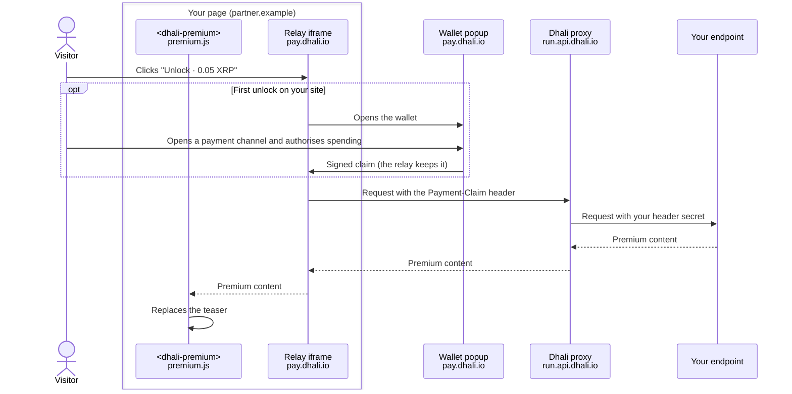

# How it works

This is for partners who want to know what runs on their page and what they're trusting. For setup, see the [README](../README.md).

## The pieces

| Piece | Served from | Job |
|---|---|---|
| `premium.js` | pay.dhali.io (pinned version, integrity hash) | Defines `<dhali-premium>`, adds the Unlock button frame, and inserts the content it receives into your page. It never sees the payment claim. |
| `relay.html` | pay.dhali.io, inside an iframe | Shows the button and price, keeps the visitor's claim, calls the Dhali proxy and passes the response back. |
| pay.dhali.io | pay.dhali.io, in a popup | The Dhali wallet. The visitor connects a wallet, opens or tops up a payment channel and approves an amount. The wallet then hands the claim to the relay. |
| Dhali proxy | run.api.dhali.io | Checks the claim, charges for the request and forwards it to your endpoint with your header secret. |
| Your endpoint | your server | Returns the premium content. |

## One unlock, step by step

1. The page loads `premium.js`. Each `<dhali-premium>` adds a small iframe showing **Unlock · price**. The price comes from Dhali's metadata for your API, not from your page.
2. **First unlock on your site:** the visitor clicks, and the wallet opens in a popup showing your API's name and price. The visitor approves an amount, for example 0.25 XRP. The wallet sends the signed claim to the relay and closes.
3. The relay calls `run.api.dhali.io/<api><path>` with the claim. Dhali forwards the request to `<your base URL><path>`, adding your header secret.
4. Your endpoint responds. The relay passes the body to `premium.js`, which replaces the teaser with it.
5. **Later unlocks on your site** reuse the stored claim, so they take one click with no popup.
6. When the approved amount runs out, Dhali refuses the request and says how much more is needed. The button shows that amount and reopens the wallet when clicked.

## Security

### The payment claim never reaches your page

A claim is a signed approval to spend up to an amount from the visitor's payment channel, on any Dhali API. If your page held it, any script on the page could spend it: ad and analytics tags, a compromised dependency, or an XSS bug. So only pay.dhali.io pages ever touch it.

- **Origin lock:** the wallet addresses the claim to the relay's origin, so the browser only delivers it to a relay window. The relay accepts a claim only from the wallet window it opened itself.
- **Per-site isolation:** browsers keep iframe storage separate for each top-level site. A claim stored while visiting your site can't be read on another site.
- **One API per section:** the relay only calls the API named in the element, and refuses any `path` that would leave it (e.g. `/../<another-api>`).
- **Every paid request needs a click inside the Dhali frame.** Your page can't trigger a payment, and the button ignores clicks until it has been on screen for half a second, which makes clickjacking harder. In Chromium this also catches the frame being covered or made transparent; other browsers only report whether it is in the viewport.

### What you trust

`premium.js` runs on your page, like any third-party script, so:

- **It's pinned.** The URL names a version, and the `integrity` hash makes the browser refuse to run the file if a single byte changes. Published versions never change.
- **It's public.** The file is served by jsDelivr (or unpkg) from the published `dhali-premium` npm package, not from a Dhali server. Download it, or the package, and check its hash against the snippet and [`releases/integrity.json`](../releases/integrity.json).
- **It's small** (about 100 lines, [`src/premium.js`](../src/premium.js)) and has no dependencies, so it's easy to review.
- **You can host it yourself.** Copy the file to your own server and keep the integrity hash. Only the relay (`relay.html`) has to come from pay.dhali.io, because it holds the visitor's claim on Dhali's origin.

`relay.html` needs no trust from you. It runs in a cross-origin iframe, can't read or change your page, and can only send messages, which `premium.js` checks come from pay.dhali.io.

The content inserted into your page comes from your own endpoint. Inserting it carries the same risk as serving it yourself.

### Your endpoint

Your base URL is public. Anyone who finds it could fetch the content directly and skip payment. The Dhali proxy adds your header secret to every request it forwards, so refuse any request without it. The [examples](../examples/) show how.

## Costs and limits

- **The visitor approves slightly more than the price.** Dhali checks each claim against a worst-case cost. The actual charge is the price plus the compute used, usually close to the listed price.
- **Each site needs its own approval**, because of per-site isolation. The visitor's payment channel is reused, so there's no new ledger transaction.
- **Popups:** the first unlock opens a popup in response to the click. If a browser blocks it, the button says so.
